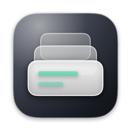
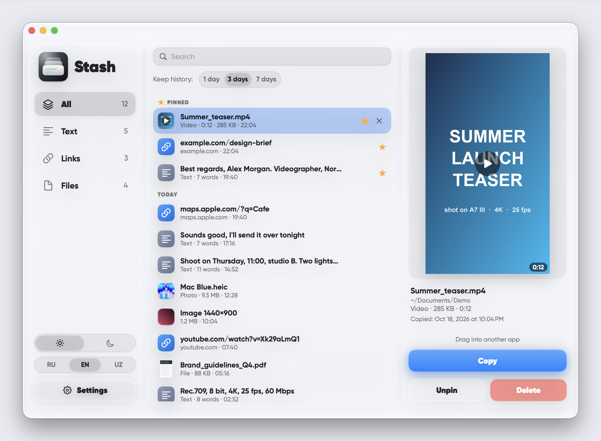
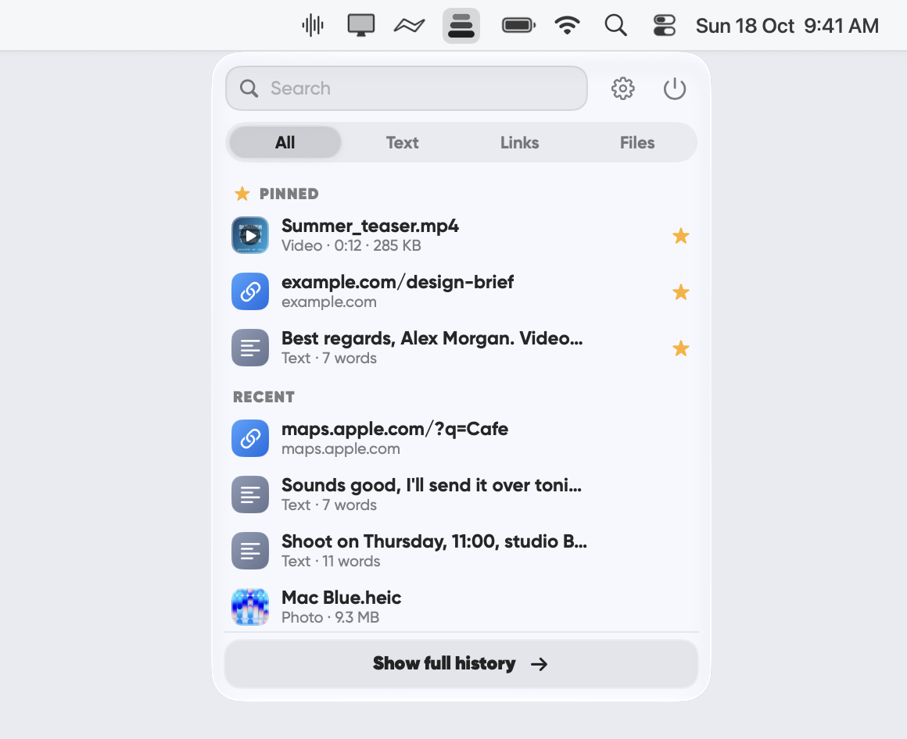
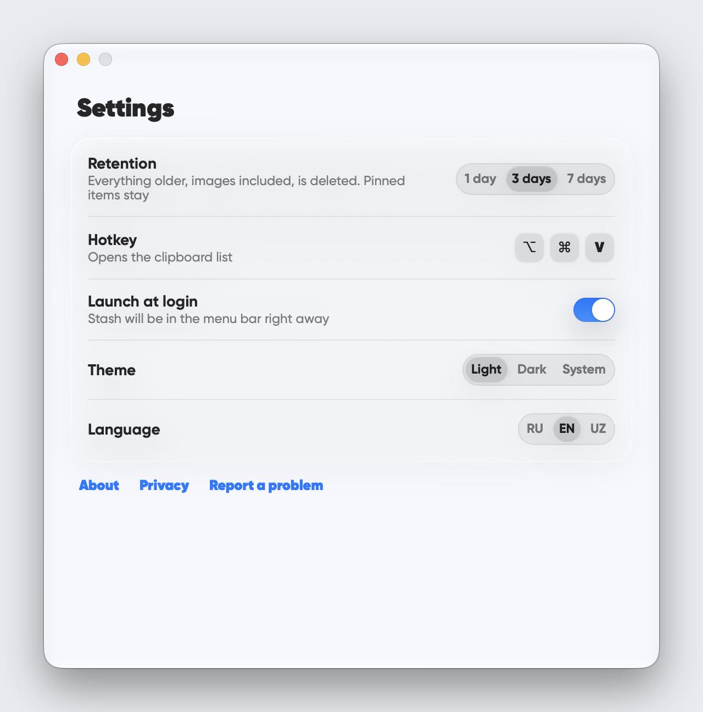
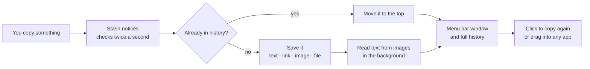

# Stash

### Your Mac's clipboard, with a memory.

&nbsp;

macOS remembers only the **last** thing you copied. Stash remembers **days** of it — text, links, screenshots, files — in a quiet little window that lives in your menu bar. Copy as usual; when you need something from earlier, it's one click away.

> ### [⬇&nbsp;&nbsp;Download Stash for Mac](https://github.com/terison-brmv/stash/releases/latest/download/Stash.zip)
> Free · macOS 13+ · Apple silicon · [all versions](../../releases/latest) · [Questions and ideas](../../issues)

 

<table>
  <tr>
    <td width="50%"></td>
    <td width="50%"></td>
  </tr>
  <tr>
    <td align="center"><b>The quick window.</b> Opens from the menu bar or a hotkey.</td>
    <td align="center"><b>Settings.</b> Retention, hotkey, login, theme, language.</td>
  </tr>
</table>

---

## Why it exists

You copy a phone number, then a link, then a screenshot — and the phone number is gone. Or you remember "that paragraph I copied yesterday" and have nowhere to find it.

Stash fixes exactly this and nothing more. It isn't a notes app, a snippet manager or a sync service. It's a **short-term memory for your clipboard**: it keeps what you copied for a few days, lets you find it fast, and then lets it go.

## The ten-second tour

1. **Copy** anything, the way you always do (⌘C, a screenshot to clipboard, a file in Finder).
2. **Press your hotkey** (default ⌥⌘V) or click the Stash icon in the menu bar.
3. **Click an item** — it goes back into your clipboard. Paste it with ⌘V wherever you like.

That's the whole loop. Stash never pastes for you and never touches your clipboard unless you click.

## How it works

- **Watching.** Stash checks the system clipboard's change counter every half second. It's a single integer comparison, so it costs practically nothing.
- **No duplicates.** Each item gets a fingerprint. Copy the same thing again and the old entry simply jumps to the top instead of piling up.
- **Expiry.** History is kept for **1, 3 or 7 days** (default 3), counted from the last time you copied the item. Older entries disappear together with their images. **Pinned** items never expire.
- **Files are references, not copies.** For files, Stash stores the path and a thumbnail, not the file itself, so your disk doesn't fill up. If a file has since been moved or deleted, Stash tells you instead of failing silently.

## What's inside

| | |
|---|---|
| **Text** | Plain and formatted text, up to 1 MB per item. Shown as a first-line preview with a word count. |
| **Links** | Shown as `domain/path`, with a one-click **Clean link** button (see below). |
| **Images & screenshots** | Real thumbnails; the full image is kept until the item expires. |
| **Files** | Photos, videos and documents. Video shows a frame and its duration, other files get Finder-style thumbnails. |
| **Hover preview** | Rest the pointer on an item's icon and a compact preview slides out: the photo, a video frame, up to 500 characters of text, or file details (name, path, size, dimensions or duration, copy time). |
| **Pinned** | Star anything to keep it. The quick window shows up to 3 pinned items, the full history shows as many as you like. |
| **Filters** | All · Text · Links · Files (photos, videos and screenshots live under Files). |

## Search that understands you

Type in the search field and the list narrows as you go. Stash searches text, links, file names **and the words inside your images**.

- **Text in images (OCR).** Screenshots and photos are read on your Mac with Apple's Vision framework, in the background, right after you copy them. Russian and English are recognised; Uzbek in Latin script is read as English letters.
- **Forgiving matching.** Apostrophe variants (‘ ’ ʻ ʼ ') count as the same character, and `ў қ ғ ҳ` match `у к г х`, `ё` matches `е`.

> Search covers text on images and photos, not the contents of videos.

## Clean link

Links copied from social networks and newsletters are full of trackers. Press **Clean link** and Stash strips `utm_*`, `fbclid`, `gclid`, `igshid`, `yclid` and similar parameters, then puts the clean address on your clipboard. The original entry stays in the list.

## Drag it out

You don't have to copy at all. Grab any item and drop it straight into an email, a chat, a document or a Finder folder. Text and links arrive as text, images as images, files as files.

## Two windows, one app

| | **Quick window** | **Full history** |
|---|---|---|
| Opens from | Menu bar icon or hotkey | Button in the quick window, or open Stash from Applications |
| Shows | 3 pinned + 10 latest | Everything, grouped by day (Today · Yesterday · Earlier) |
| Best for | "I need that thing from a minute ago" | "Where was that screenshot from Tuesday?" |
| Extras | Hover preview, filters, search | Detail panel with big preview, path, size, Copy / Pin / Delete |

**Menu bar and Dock.** Stash lives in the menu bar. Open it from Applications and the full-history window appears with a Dock icon; close the window and the Dock icon goes away while Stash keeps running in the menu bar. When it starts at login, it stays quietly in the menu bar and doesn't open any window.

## Make it yours

- **Hotkey:** ⌥⌘V by default; set any combination in Settings.
- **Retention:** 1, 3 or 7 days.
- **Launch at login:** one switch.
- **Theme:** light, dark, or follow the system (it switches on its own when macOS does), with a smooth cross-fade between them.
- **Language:** English, Русский, O‘zbekcha, switchable at any time.
- **Look:** Apple's real **Liquid Glass** on macOS 26 and later, with a frosted-glass look on macOS 13–15.

## Private by design

Stash has **no account, no server, no analytics and no network code at all**. Your history is stored in one folder on your Mac and nowhere else. See the short [privacy note](PRIVACY.md).

<b>Where is my data?</b>

 

`~/Library/Application Support/Stash/`

It holds a small `items.json` (the history), `settings.json`, and folders for images, thumbnails and rich text. Quit Stash and delete the folder to wipe everything; the app starts fresh next time.

<b>Does Stash record passwords?</b>

 

Stash records what lands on the clipboard, like any clipboard history. There's no password-manager filter and no pause button in this version, so if you copy a password it will be in the history until it expires (or until you delete it with the ✕ on the item). Pick a shorter retention if that matters to you.

<b>Will it fill up my disk?</b>

 

Text is tiny. Images are stored once, and everything expires on schedule. Files are only referenced, never duplicated. In normal use the folder stays small.

<b>Why does macOS warn me the first time?</b>

 

Stash is a small independent app, not distributed through the App Store, so macOS asks you to confirm it once. See **Install** below.

## Install

1. Download [`Stash.zip`](https://github.com/terison-brmv/stash/releases/latest/download/Stash.zip) (or pick a version from the [releases](../../releases/latest)).
2. Unzip it and drag **Stash** to your **Applications** folder.
3. The first time, macOS says it can't verify the app. Open **System Settings → Privacy & Security**, scroll down, click **Open Anyway** next to Stash, and confirm. You only need to do this once. (On macOS 15 and later, right-click → Open no longer skips this warning.)
4. Open Stash. Turn on **Launch at login** in Settings if you'd like it always ready.

**Requirements:** a Mac with Apple silicon and macOS 13 or newer (tested on macOS 26).

## Feedback

Found a bug or have an idea? Click **Report a problem** in Stash's Settings, or open an [issue](../../issues/new/choose) here. A short description and a screenshot help the most. Please include the Stash and macOS versions.

## Author and license

Made by **terison_brmv**. Free to use, all rights reserved: see [LICENSE](LICENSE). The app bundles the Gilroy font; see [third-party notices](THIRD-PARTY-NOTICES.md). Modifying, reselling or redistributing the app without the author's permission is not allowed.
